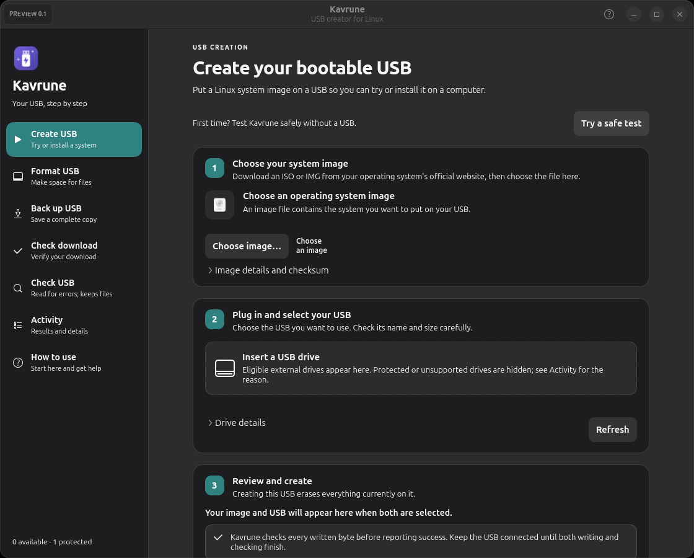

# Kavrune

An independently implemented Linux desktop application for creating and verifying USB installation media. Written in C++20 with GTK4/libadwaita, GIO D-Bus, and OpenSSL. Project source and original icon are MIT licensed.

**0.1.0 is a development preview.** Production qualification, broader physical USB validation and independent security review remain pending. Kavrune is an independent project with original source and artwork; the selected project name does not imply completed trademark clearance.

**No warranty; use at your own risk.** Kavrune is provided "as is". To the fullest extent permitted by applicable law, its authors and copyright holders are not responsible or liable for claims, damages or losses arising from the software or its use, including data loss, corrupted media or device and system damage. Keep independent backups and review the [disclaimer](DISCLAIMER.md) and [MIT License](LICENSE).

Read the [terms of use](TERMS.md) and [privacy notice](PRIVACY.md). The app includes an offline **Legal & privacy** reader under **How to use**, also accessible from **About Kavrune**, with license, third-party notices and support information. These notices explain behavior and risks without adding restrictions to the MIT License or requiring a separate consent screen.



## Start the application

If the desktop package is installed, open **Kavrune** from your application menu. From this source checkout:

```sh
./scripts/run.sh
```

The compiled desktop application is `build/kavrune`; the CLI is `build/kavrune-cli`. Run as your normal desktop user. UDisks2 and your desktop's Polkit authentication agent authorize individual storage operations.

First click **Try a safe test** on **Create USB**. It uses temporary files to exercise the image writer and readback check; no ISO or USB is required and no physical drive is opened.

For your first physical trial, use a spare USB with no important files. **Create USB** explains what to prepare before starting and how to start a computer from the finished USB. You do not need to format the USB first. Choose the downloaded Linux image, open **Choose a USB drive…**, select your USB by its name and size, and review the erasure confirmation. The chosen drive stays selected across tools and refreshes while the same physical device remains connected.

Kavrune shows five stages: check the image, write, save buffered data, verify, and finish. Saving can take time even after all image bytes have been written; an animated indicator and elapsed time show that the operation is still running. The overall bar reaches 100% only after the operation finishes, including verification and the final device rescan. Leave the USB connected until **Written and verified**. A verified write is separate from a boot test on the intended computer.

Read the [beginner guide](docs/GETTING_STARTED.md) for each step, use the [USB test checklist](docs/USER_TEST_CHECKLIST.md) to record your results, and see [feature status](docs/FEATURE_STATUS.md) for what remains to qualify.

See [image compatibility](docs/IMAGE_COMPATIBILITY.md) for supported BIOS/UEFI hybrid profiles and help with refused files. **Check download** can compare complete unsupported files with a publisher's checksum while USB creation stays blocked for those files.

## Available features

| Operation | Behavior |
|---|---|
| Create USB | Write a supported Linux installer or restore a raw drive backup; preserve the image's partition and boot layout |
| Device discovery | UDisks2 discovery, hotplug refresh, whole-drive filtering and hardware identity checks |
| Drive protection | System/storage ancestry, configured drives, active swap, holders, read-only and internal disks excluded |
| Verification | Mandatory SHA-256 comparison after writing; errors and incomplete operations reported |
| Format USB | Choose a USB name and file-storage use; partition settings are under Advanced settings; invalid options are explained before confirmation |
| Back up USB | Save the entire drive to a new IMG file; check available space, refuse overwrites and report SHA-256 |
| Check download | Calculate SHA-256 or SHA-512, identify the calculated algorithm, and optionally compare the publisher's checksum; CLI also supports legacy SHA-1/MD5 |
| Check USB | Read the reported capacity and report read errors without writing data |
| Activity | Bounded private per-user history; reload, copy, save to a new file or clear retained diagnostics with confirmation |
| How to use | In-app steps, explanations, feature limits and searchable offline terms, privacy, disclaimer and MIT license |
| CLI | Same image engine and storage validation as desktop; JSON device/image output |
| Packaging | Desktop entry, original SVG icon, AppStream metadata, `.deb` and SPDX inventory |

Windows installer extraction/WIM splitting, NTFS formatting, compressed-image streaming, distribution-specific persistence, destructive fake-capacity testing, and automatic Linux/Windows installer boot qualification on BIOS/UEFI are **not implemented**. Optical-only and Windows installation images are blocked from raw USB creation. A read-only scan cannot establish actual flash capacity. See [feature status](docs/FEATURE_STATUS.md) and the [release roadmap](docs/ROADMAP.md).

Only external drives with verifiable identities are eligible. Some adapters expose insufficient serial information and will be refused. Filesystems whose physical ancestry cannot be established are refused where necessary for safety. There is no internal-disk override.

## Build

Source targets Ubuntu 24.04+ with GCC 12+, CMake 3.22+, GTK 4.12+, libadwaita 1.4+, OpenSSL 3 and UDisks2 2.9+. Distribution support requires validation; a package built on Ubuntu 26.04 may depend on newer runtime libraries than Ubuntu 24.04 provides. Build releases on the oldest supported distribution.

Standard development packages on Ubuntu:

```sh
sudo apt install build-essential cmake pkg-config libgtk-4-dev libadwaita-1-dev \
  libssl-dev udisks2 polkitd dosfstools exfatprogs e2fsprogs
./scripts/build.sh
```

For development without installing headers system-wide, the helper can download and extract development packages into the ignored `.deps` directory on a host with matching runtime libraries:

```sh
python3 scripts/local-dev-deps.py
./scripts/build.sh
```

The local-header approach is for development on a matching Ubuntu host; it is not a portable SDK. Normal builds use distribution packages. Every build runs the regression tests.

```sh
./scripts/package.sh
```

Packages and the dependency inventory appear under `dist/`. Packaging extracts and checks the new archive without installing it: legal documents, guides, embedded offline notices, desktop metadata, executable permissions and ELF hardening must pass, followed by a disposable-file CLI self-test. The check requires `dpkg-deb`, `readelf` and `gresource` (from `dpkg`, `binutils` and `libglib2.0-bin`). You can repeat it with `python3 scripts/check-package.py dist/kavrune_0.1.0_amd64.deb --self-test`.

The package is also checked under process-local network denial and a disposable extraction/overlay/removal/reinstall fixture that preserves user-data sentinels. These checks do not constitute clean-VM package-manager installation or a supported-distribution qualification. Reports and an unsigned source/artifact manifest are saved in `dist/`. Optional manual signing with an existing maintainer key is described in [RELEASE_CHECKLIST.md](RELEASE_CHECKLIST.md); no signing key or automatic update service is created.

Installing the package is a separate user action. It installs no root application, custom daemon, setuid executable, permissive Polkit rule, or downloaded bootloader.

## Safe test without a USB drive

After building, run:

```sh
./build/kavrune-cli self-test
```

The self-test generates a small sample image, writes a temporary regular-file copy through the shared engine, and verifies the result. It needs no downloaded installer, USB, storage-service access or password prompt. A passed test checks file-based writing; it does not qualify physical drives or firmware. Add `--json` for a machine-readable result, including `physical_usb_tested: false`.

To test an image you supply, create a new file destination:

```sh
./build/kavrune-cli inspect path/to/image.img
./build/kavrune-cli simulate path/to/image.img /tmp/new-test-drive.img
./build/kavrune-cli checksum /tmp/new-test-drive.img
```

Simulation requires a new regular-file destination and always verifies the written bytes. It never opens a physical storage device. Existing files and symlink image sources are refused.

Raw image writing replaces the image-length prefix of the drive. It is not a secure full-drive erase; older data and signatures beyond that length may remain. Release qualification includes checking stale partition signatures and media prepared by other tools.

```sh
ctest --test-dir build --output-on-failure
./build/kavrune --smoke-test
./scripts/test-boot.sh ./build/kavrune-cli
```

Regression tests use synthetic data in temporary files, not physical drives. The desktop build adds real GTK dropdown and desktop-control tests for selecting, refreshing, clearing and sharing a target across tools. The desktop-control test constructs a hidden window; neither test discovers or opens drives. They use Xvfb when available, otherwise require a display and report a skip if none is available. `--smoke-test` briefly opens the desktop UI and exits without changing storage.

The regression suite covers corruption, cancellation, image mutation, identity changes, image metadata bounds, overwrites and symlinks. The optional boot script uses system QEMU/SeaBIOS to boot an original synthetic MBR image after writing/verifying it; it skips when QEMU is unavailable. Read the [recorded local results](docs/BUILD_RESULTS.md) for completed checks. Real Linux/Windows installer booting, USB writing, format tooling, unplug behavior, and Polkit prompts require the disposable-hardware/VM release matrix in [VALIDATION.md](docs/VALIDATION.md).

## CLI

```sh
./build/kavrune-cli --help
./build/kavrune-cli devices --all --json
./build/kavrune-cli inspect image.iso --json
./build/kavrune-cli checksum image.iso --algorithm SHA256 --expected HEX_DIGEST
```

Destructive CLI commands require both the stable drive ID from `devices` and an exact matching `--confirm /dev/DEVICE` path. CLI authorization still requires a working Polkit agent. Consult `--help` for write, format, backup and scan syntax. SHA-1 and MD5 are compatibility checksums, not modern authenticity verification.

Logs are stored at `$XDG_STATE_HOME/kavrune/events.log` or `~/.local/state/kavrune/events.log`, with a private directory and files. A current and previous generation are capped at 256 KiB each, with 8 KiB records and UTC timestamps/severity. Activity supports reload, user-directed export and confirmed clearing. Details can contain local paths or device identifiers; review before sharing. There is no age expiry or telemetry. See the [privacy notice](PRIVACY.md) for retention, deletion, backups and clipboard handling.

```sh
./build/kavrune-cli diagnostics
./build/kavrune-cli diagnostics --export new-diagnostics.txt
./build/kavrune-cli diagnostics --clear --confirm clear
```

The GUI uses gettext for localization; translations and a complete accessibility audit are still release work. See [accessibility and keyboard use](docs/ACCESSIBILITY.md), the [architecture](docs/ARCHITECTURE.md) and [validation requirements](docs/VALIDATION.md) for implementation details and release limits.

## Open source and contributing

Original project code, documentation and artwork are available under the [MIT License](LICENSE), copyright 2026 Kavrune contributors. Dependencies retain their own licenses; see [third-party notices](THIRD_PARTY_LICENSES.md) and the [licensing guide](docs/LICENSING.md).

Read [CONTRIBUTING.md](CONTRIBUTING.md) before submitting a change and follow the [Code of Conduct](CODE_OF_CONDUCT.md). Public issues are suitable for ordinary bugs and feature requests. Use the private reporting process in [SECURITY.md](SECURITY.md) for vulnerabilities, and review the [storage disclaimer](DISCLAIMER.md) before writing a drive.

See the [changelog](CHANGELOG.md) for preview scope and the [GitHub publishing guide](docs/PUBLISHING.md) for repository setup and release steps. Follow [SECURITY.md](SECURITY.md) for the available vulnerability reporting process.

The [production audit](docs/PRODUCTION_AUDIT.md) records the earlier review. The [complete desktop standards assessment](docs/STANDARDS_ASSESSMENT.md) maps all 25 supplied principles and 24 release criteria to current implementation, evidence, remaining work and inapplicable features. Permanent [product standards](PRODUCT_STANDARDS.md), [requirements](PRODUCT_REQUIREMENTS.md), [architecture](ARCHITECTURE.md), [privacy/legal inventory](PRIVACY_AND_LEGAL.md), [test plan](TEST_PLAN.md) and [release checklist](RELEASE_CHECKLIST.md) ship with the package. Passing local tests and adding notices do not complete production qualification.
