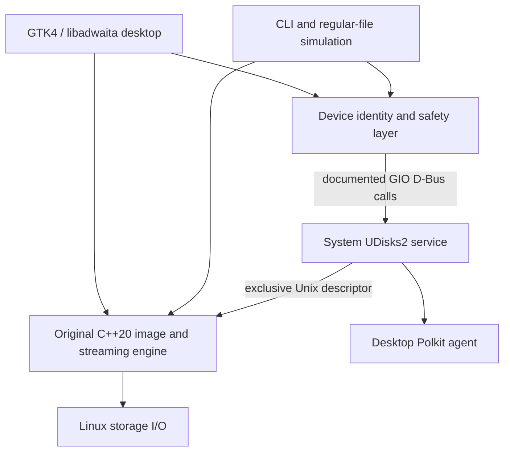

# Architecture

`include/kavrune/core.hpp` defines the shared domain objects and cancellable streaming operations. `src/core.cpp` performs image inspection, digests, writing, verification, backups, read scans and private logging. Its tests do not require GTK or privileged storage.

`include/kavrune/storage.hpp` and `src/storage.cpp` wrap only the required UDisks interfaces. The original daemon proposed in the PRD is unnecessary for this first milestone: UDisks already supplies the privileged service, Polkit authorization and descriptor transfer. A custom root daemon would create an additional security surface without enabling a necessary feature here.

`src/desktop.cpp` creates the native UI and dispatches blocking work to workers. GTK updates return to the main context; operations prevent concurrent storage actions. Hotplug enumeration runs independently while idle. The selected device/image are copied into an operation before confirmation/execution.

`src/cli.cpp` shares the same engine and safety layer. The simulation command creates a new regular file and never requests block access. `CMakeLists.txt` builds both entry points, embeds original UI assets, runs CTest and creates Debian packages.

The raw writer does not repartition first. An image already contains its own layout, so it is streamed intact. Separate formatting creates a blank data drive and cannot create a bootable installer by itself. Secure Boot signatures in raw images are preserved byte for byte; their validity is not independently certified.

API references: [UDisks Block](https://storaged.org/doc/udisks2-api/latest/gdbus-org.freedesktop.UDisks2.Block.html), [UDisks PartitionTable](https://storaged.org/doc/udisks2-api/latest/gdbus-org.freedesktop.UDisks2.PartitionTable.html), [GIO Unix descriptor calls](https://docs.gtk.org/gio/method.DBusConnection.call_with_unix_fd_list_sync.html), [GTK](https://docs.gtk.org/gtk4/), [libadwaita](https://gnome.pages.gitlab.gnome.org/libadwaita/doc/main/).
