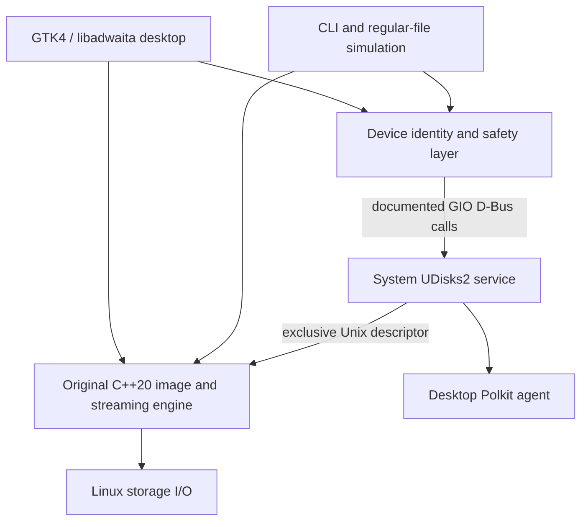

# Architecture

The [root architecture summary](../ARCHITECTURE.md) and [desktop standards assessment](STANDARDS_ASSESSMENT.md) document current trust boundaries and release scope. Diagnostics now use a stable private process lock and bounded current/previous logs; reload/export/clear share the same safe core API. Generated build-version data comes from CMake. Release checks exercise local temporary-file and private-display workflows with process-level network denial; no server is introduced.

`include/kavrune/core.hpp` defines the shared domain objects and cancellable streaming operations. `src/core.cpp` performs image inspection, digests, writing, verification, backups, read scans and private logging. The shared safe self-test creates private temporary regular files, exercises the writer and readback check, and removes its files on success, failure or cancellation. Its tests do not require GTK or privileged storage.

`include/kavrune/storage.hpp` and `src/storage.cpp` wrap only the required UDisks interfaces. The original daemon proposed in the PRD is unnecessary for this first milestone: UDisks already supplies the privileged service, Polkit authorization and descriptor transfer. A custom root daemon would create an additional security surface without enabling a necessary feature here.

`src/desktop.cpp` creates the native UI and dispatches blocking work to workers. GTK updates are queued as idle sources on the main context; operations prevent concurrent storage actions. Hotplug enumeration runs independently while idle. The selected device/image are copied into an operation before confirmation/execution. The desktop binds the selected image to its device, inode, size, modification/change times and SHA-256; the writer checks the pinned source descriptor and digest before its first target write and requires the written digest to match. A failed publisher-checksum comparison blocks creation.

`src/cli.cpp` shares the same engine and safety layer. The simulation command creates a new regular file and never requests block access. `CMakeLists.txt` builds both entry points, embeds original UI assets, runs CTest and creates Debian packages.

The raw writer does not repartition first. An image already contains its own layout, so it is streamed intact. Separate formatting creates a blank data drive and cannot create a bootable installer by itself. Secure Boot signatures in raw images are preserved byte for byte; their validity is not independently certified.

Some bootable hybrid ISOs deliberately map their first populated GPT partition from sector zero, including the partition metadata. The inspector permits this convention only after validating the ISO descriptors, inspected directories, El Torito boot catalog and MBR carrier. The carrier's nonzero GPT type GUID may be generator-selected, and unused entry slots may precede it. MBR types are not restricted to type zero; validated type-zero whole-image carriers and one-sector placeholders are also recognized, with a placeholder alone insufficient to establish a USB disk layout. Only the first populated GPT entry can use the sector-zero lower-bound exception; GPT checksums, partition-table limits, upper bounds and all other entries remain checked. Ordinary GPT disk images retain strict usable-range validation. See the [image profiles](IMAGE_COMPATIBILITY.md), [xorriso hybrid GPT documentation](https://www.gnu.org/software/xorriso/man_1_xorriso.html) and [Alpine's image builder](https://github.com/alpinelinux/aports/blob/master/scripts/mkimg.base.sh).

Image inspection accepts BIOS and UEFI El Torito default/section entries, EFI zero/one-sector load conventions, ISO type-2/version-2 enhanced descriptors and complete UDF recognition sequences around ISO descriptors. UDF-only and detected Windows/optical-only images remain read/checksum profiles, without raw-write permission. Typed image issues give the desktop a specific recovery action. In Check download, complete files that fail inspection can fall back to identity and checksum checks while retaining `raw_writable = false`; unfinished-download suffixes do not enter that fallback. Inspection caps volume descriptors at 256, each inspected ISO directory at 4 MiB and boot-catalog records at 4,096. A checksum comparison never upgrades a refused image to writable.

API references: [UDisks Block](https://storaged.org/doc/udisks2-api/latest/gdbus-org.freedesktop.UDisks2.Block.html), [UDisks PartitionTable](https://storaged.org/doc/udisks2-api/latest/gdbus-org.freedesktop.UDisks2.PartitionTable.html), [GIO Unix descriptor calls](https://docs.gtk.org/gio/method.DBusConnection.call_with_unix_fd_list_sync.html), [GTK](https://docs.gtk.org/gtk4/), [libadwaita](https://gnome.pages.gitlab.gnome.org/libadwaita/doc/main/).
